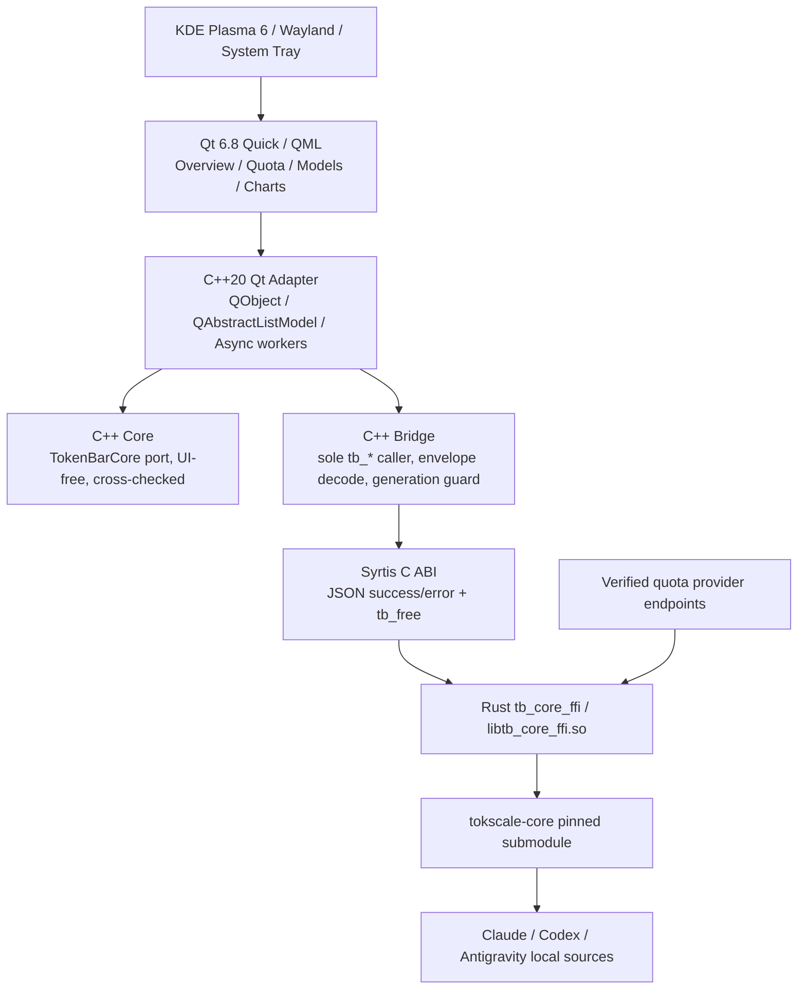

# Syrtis Linux Qt6 — Architecture and Decision Records

**版本**：v1.1.0 / 2026-10-15（PR-00 修訂）。**原則**：已同意的架構選擇 ≠ 相容性實測通過。每項技術風險透過 PR-00 驗證。

## A. 高階架構

**資料約束**：Rust 是 Token、成本、時間歸屬及 quota 的唯一資料來源。上游 `Sources/TokenBarCore` 擁有的 UI-free 計算（day bars、grid layout、linear pace policy、QuotaResolver、ClientRegistry、usage attribution、formatting）在 Linux 由 **C++ Core** 移植並以 cross-check fixture 對拍（ADR-011）；Qt Adapter／QML 不重新聚合。必要 Client 篩選在 Rust 預聚合之前執行，不能只過濾最終混合值。FFI 的 JSON `{"ok":true,"data":...}` / `{"ok":false,"err":...}` 必須保留，C 字串所有權由 `tb_free` 管理。Linux 呼叫不得在 QML/GUI Thread 上阻塞。

## B. ADR 清單

### ADR-001：Fork + Linux 專用移植層

**狀態：Accepted（規劃層）**。Fork `Nanako0129/syrtis`，命名 `syrtis-linux`，保留上游歷史、`Sources/`、`crates/`、`vendor/tokscale-core`。優先新增 `linux/`（Qt/CMake/packaging/tests），文件新增 `docs/linux-port/`；不要初期就刪除或搬動 macOS app。若上游架構日後發生大變更，再獨立 ADR 決策是否獨立拆庫。公開 Fork 不可變成 Private。

### ADR-002：Rust 是資料正確性核心

**狀態：Accepted**。重用 `tokscale-core` 的 scanner/parser/dedup/pricing/aggregation；`crates/tb_core_ffi` 已同時宣告 `["cdylib","staticlib"]`（兩者皆須保留，Windows 依賴 cdylib）；**Linux app 連結 staticlib**（與 macOS 相同，免 SONAME／rpath／私有 lib 安裝），cdylib 僅用於 smoke／symbol 檢查。Toolchain 以 rustup 鎖定 engine 的 `rust-toolchain.toml`（1.96.1），不使用 Debian 套件 rustc。PR-00 實測：基線在 Linux **無法編譯**（非 macOS stub 簽名漂移），一行修正後 release build、2,383 項測試通過，見 [`evidence/rust-feasibility.md`](evidence/rust-feasibility.md)。先檢查相依和 cfg；只在必要時修改 app-owned FFI。任何共用 engine 改動先分析上游同步方案、單獨審核 gitlink，不在 fork 的 submodule 直接編輯未追蹤內容。

### ADR-003：Qt ↔ Rust 透過現有 C ABI

**狀態：Accepted，P0 需驗證**。使用 C++ Adapter 呼叫 FFI，受控轉換 JSON DTO 成 `QObject` / `QAbstractListModel`。C++ 處理指標和錯誤、不允許懸垂字串；釋放 `tb_free`。`ctb.h` 的簽名不能悄悄更改；若需擴充，優先 additive symbol，並記錄其他消費者（包括 Windows）的相容性。Linux 對 26 個 symbol 的支援矩陣見 evidence；`tb_antigravity_capture`／`_remove`／`_login_marker`／`_auto_capture`、`tb_set_antigravity_binding`／`_accounts`、`tb_set_keychain_consent`、`tb_set_claude_config_dirs`、`tb_set_cursor_sync`／`tb_cursor_sync` 在 Linux v1 不由 UI 呼叫。所有 `tb_*` 皆為阻塞且不可取消。QML 不直接存放 Token 或執行網路請求。

### ADR-004：Qt 6.8 + Qt Quick/QML（不是 SwiftUI）

**狀態：Accepted**。首要 Debian 13 的發行版 Qt 6.8，建置採 CMake + Cargo。使用 Qt Quick/QML 實作主要 UI，Qt Widgets 僅適用系統匣/原生選單。托盤後端（`QSystemTrayIcon` 或 KF6 `KStatusNotifierItem`）待 PR-00 Qt spike 量測 Plasma Wayland 點擊開窗的 xdg-activation 焦點行為後決定。不要額外引入 CXX-Qt，除非未來 ADR 實證現行 ABI 的維護成本過高。

### ADR-005：MIT 主程式與 Qt 授權邊界

**狀態：Accepted；發布前需法律及依賴查核**。保留原 LICENSE 及 2024 handlecusion、2025 Junho Yeo、2026 Nanako 等 Copyright；新修改加上適切署名。使用可符合 LGPLv3 授權要求的 Qt 模組並維持動態連結；遵守 LGPL 的授權告知、替換／重新連結能力和相關義務。Qt 6.8 **Qt Charts、Qt Graphs、Qt Quick 3D** 等官方列為 GPL-only/商業授權，未獲另行授權不得直接納入本方案。第三方圖示、字型、動畫、圖片逐項建檔。此為工程性授權約束，不取代正式法律意見。

### ADR-006：3D 貢獻圖使用可控的 MIT 相容渲染

**狀態：Proposed（修訂）；P0 技術選型關卡**。**首選（方案 A）**：CPU 正交 orbit 投影 + painter's algorithm 排序 + CPU 命中測試，以 `QQuickPaintedItem` 繪製（所有 scene graph backend 含 software 皆可用）；參數沿用 macOS／Windows spike（53×7、高度 `0.15 + 3.0·frac^0.6`、色階 `#BFDBFE→#1E3A8A`、`tokenbar.orbit.v1` 相機契約）。**方案 B**（A 量測不達標時）：`QSGGeometryNode` + 內建 `QSGVertexColorMaterial`。**禁止自訂 shader**：自訂 `QSGMaterialShader` 需 `qsb`，而 Qt 6.8 文件標示 `qsb` 為 GPLv3／商業授權。**否決 Qt WebEngine 退路**（記憶體、攻擊面、Chromium 授權）。以下為原始文字，保留供對照：Qt Quick Scene Graph / `QSGGeometryNode`（Qt Quick LGPL 模組）建構柱狀幾何和相機投影：資料在 CPU 端生成、旋轉/縮放/點擊日期／Tooltip 皆自有邏輯；不依賴 GPL-only Quick 3D。P0 應完成最小旋轉/命中測試、Wayland 與 llvmpipe 渲染可行性。若實測難度或效能不合格，評估在 Qt WebEngine 的**離線、限制外部網路**視圖中放置適用授權的 WebGL/Three.js；同時評估 Chromium 記憶體、啟動速度與 LGPL/第三方授權。最終選型須由使用者核准後落成 ADR 決策；不得在 3D 實作 PR（PR-06）才臨時決定。

### ADR-007：KDE/Wayland 桌面整合

**狀態：Accepted**。使用 Qt `QSystemTrayIcon`，遵守 KDE StatusNotifierItem 行為；Tray 圖示、Tooltip、選單與點擊開窗需在真實 Wayland 驗證。不要保證 macOS 一樣可在面板直接畫任意文字。**Wayland 不允許 client 自訂頂層視窗位置，SNI 托盤亦不提供圖示座標，因此無法重現 macOS 錨定 popover**；v0.1 採一般視窗（維護者 2026-10-15 接受），LayerShellQt 錨定面板為後續選項。使用 XDG autostart、Desktop Entry、D-Bus notification，單實例需驗證；高 DPI、多螢幕、面板上下左右位置納入測試。

### ADR-008：認證與 Quota 不跨帳號混用

**狀態：Accepted，P0 需查核 Linux Credential Sources**。只讀已有合法登入來源，例如 CLI 產生的受權檔案（Codex：`$CODEX_HOME/auth.json`；Antigravity：`~/.gemini/oauth_creds.json` 與執行中 Language Server；Claude：維護者使用 Claude desktop 帳號登入，Linux 憑證來源待 PR-04 查核，現行程式僅認 `~/.claude/.credentials.json` 與 `CLAUDE_CODE_OAUTH_TOKEN`）；優先不複製、不另存秘密。若某平台需要保存 token，僅在明確同意下評估 freedesktop Secret Service/libsecret，不能把 Token 寫進普通 JSON/Log。Antigravity macOS `agy`/Keychain 路徑不適用 Debian，不可假設既有 Rust Provider 在 Linux 已經可用。認證/刷新僅依使用者授權；失敗保持原本 CLI 憑證不變。quota snapshot account scope 與歷史 scope 不得混用。

### ADR-009：非同步與狀態管理

**狀態：Accepted**。FFI／IO 在 Worker（報表與 quota 各用獨立工作執行緒，避免 `tb_agent_usage` 最長約 30 秒的單飛呼叫餓死報表）；主執行緒只發出指令和更新 ViewModel。`tb_*` 無法中途取消：「取消」定義為以 publication generation 丟棄過期結果；程式結束時對執行中的 FFI 呼叫做有上限的等待。須有 timeout 與防亂序機制；關閉頁面不留無必要 timer；網路 429 指數回退。錯誤與最後有效值同時顯示，但 last-good 必須同一 credential binding。

### ADR-010：發行與上游維護

**狀態：Accepted**。第一個可發行格式為 `.deb`；CI 執行 Cargo Test、FFI Smoke、CMake/CTest、QML basic tests、License/SBOM check。GitHub Release 和自動化發布須另行授權；Fork 內保留 `upstream` remote，pin `tokscale-core`，定期以獨立 PR 選擇性同步。預設不自動複製上游 tag 或 macOS 發布。更新前保持 ABI/DTO fixture 對拍。

### ADR-011：C++ Core 移植 TokenBarCore 並加入 cross-check

**狀態：Proposed（PR-00）**。`linux/core/` 為只依賴 QtCore 的 UI-free 函式庫，逐檔移植 `Sources/TokenBarCore` 中顯示端所需的邏輯；不呼叫 FFI、不做 IO。以 `Fixtures/CrossCheck/` 與 Syrtis-Windows `crosscheck/`（`usage-pace`、`format`、`provider-quota-pace-v3`）產生 C++ harness 輸出，用同一 `diff.py` 規則（字串逐 byte、數字 epsilon 1e-9）與 Swift 對拍。

### ADR-012：Linux 帳號範圍金鑰的亂數來源

**狀態：Proposed（PR-00 實測阻斷）**。`agent_account_scope.rs` 的 `random_bytes` 在非 macOS 回傳 `UnsupportedPlatform`，安裝金鑰無法建立；實測 Codex／Antigravity quota 皆在發出請求前以「account identity could not be verified」終止。PR-01 以 `cfg(target_os = "linux")` additive 實作 OS CSPRNG（讀 `/dev/urandom`，`read_exact`；不新增 crate 依賴），沿用既有 `0700`／`0600`、fail-closed 儲存契約；暫不提案回上游（維護者 2026-10-15）。

### ADR-013：Antigravity 在 Linux 的範圍

**狀態：Accepted（維護者 2026-10-15）**。Token：依賴 `tokscale antigravity sync`（PR-00 實測可產生快取並由 FFI 讀出）；quota：Language Server（`/bin/ps` + `lsof`，PR-00 觀察到可辨識的 process）與 OAuth（`~/.gemini/oauth_creds.json`；OAuth client 掃描根需加入 Linux 安裝位置，例如 `/opt/antigravity`）。`agy`／Keychain 路徑不適用。

### ADR-014：與 tokscale CLI 共用設定目錄

**狀態：Proposed（PR-00 發現）**。engine 與使用者安裝的上游 tokscale CLI 皆使用 `$XDG_CONFIG_HOME/tokscale`，共用 `cache/source-message-cache-v2` 與定價快取。兩者 cache 版本計數器各自獨立；風險是互相判定對方 shard 過期而重掃（效能），PR-01 須以 fixture 驗證不會讀錯 layout。Antigravity sync 快取位於同一目錄，因此不以 `TOKSCALE_CONFIG_DIR` 隔離。

## C. 生命週期與資料流詳細說明

1. 使用者開啟托盤視窗，QML 只請求 Snapshot；C++ Adapter 啟動背景任務呼叫 FFI，取得帶有 generation 的結果。
2. Rust Scanner 讀受支援 Session 路徑，傳回按所選 Client／日期聚合的資料；Qt 解碼後以 immutable Snapshot 更新模型。
3. Provider quota 另外輪詢（預設從 5 分鐘可配置，需考慮各 Provider 規則），獲取確定來源；錯誤顯示 stale/unknown/unauthorized，不可當 0 或 100%。
4. UI 視窗關閉後停止高成本圖表/動畫輪詢；只有明確設定的輕量常駐 Tray 更新可保留。
5. 封裝 `.deb` 使用發行版動態連結 Qt；XDG config/cache/state 分離；解除安裝不擅自刪除使用者資料（提供清理文件）。

## D. P0 風險登錄

| 風險 | 影響 | P0 緩解 | 失敗時 |
| --- | --- | --- | --- |
| Rust FFI macOS-only API 編譯失敗 | 阻斷 | Linux toolchain build + 符號/錯誤 smoke | 停止進入大型 UI；縮小可移植 FFI 範圍 |
| Antigravity 認證/用量並非跨平台 | 高 | Linux IDE 端實測 + 模擬資料 | 明示 Partial/Blocked，不捏造 Token |
| GPL Qt 3D 依賴 | 高 | BOM + QSG spike | 禁止該依賴，換 renderer 或延後 3D |
| 多帳號 last-good 資料交叉 | 高 | 合成帳號切換 fixture | 阻斷發布 |
| Wayland 面板/彈窗定位 | 中 | KDE 真機測試與多螢幕矩陣 | 使用獨立常規視窗退路 |
| 核心 gitlink 自動升級 | 中 | 精確 pin + PR review | revert 更新並回退 |
| Fork 暴露私人資訊 | 高 | 流程防洩露、synthetic fixtures、Log 清洗 | 立即停止寫入公開 PR |
| Linux account scope 無 RNG（PR-00 實測） | 阻斷 quota | ADR-012 | quota 不得發布 |
| Claude Linux 憑證來源未知 | 高 | PR-04 查核 desktop 帳號登入的落地位置 | Claude quota 標示需要登入 |
| 托盤點擊／重複啟動拿不到焦點（Wayland） | 高 | PR-00 Qt spike：xdg-activation | 退回一般視窗與通知 |
| C++ Core 數值與 Swift 分歧 | 高 | ADR-011 cross-check | 阻斷發布 |
| fork 中 `gh pr create` 預設指向上游 | 高 | `gh repo set-default` + 一律 `--repo` | 立即關閉誤開 PR |
| 繼承的 macOS workflow（`runs-on: xcode-27`、簽章 secrets、cron） | 中 | fork 的 Actions 已於 repo 層級關閉；啟用前先逐一停用 5 個 workflow | 停用 Actions |
| 與 tokscale CLI 共用快取（ADR-014） | 中 | PR-01 fixture | 重新評估目錄隔離 |

## E. 來源

- https://github.com/Nanako0129/syrtis/blob/main/docs/knowledge/architecture.md
- https://github.com/Nanako0129/syrtis/blob/main/Sources/CTB/include/ctb.h
- https://github.com/Nanako0129/syrtis/blob/main/crates/tb_core_ffi/src/agent_antigravity.rs
- https://github.com/Nanako0129/tokscale-core
- https://doc.qt.io/qt-6.8/licensing.html
- https://doc.qt.io/qt-6.8/qtquick-visualcanvas-scenegraph.html
- https://doc.qt.io/qt-6.8/qtwebengine-licensing.html
